<div align="center">


<br/>

[](https://axolotl26.github.io/Vocabri/)
[](https://axolotl26.github.io/Vocabri/)
[](#-instalación-y-uso)
[](#-tecnologías)
[](LICENSE)

**[🚀 Probar la aplicación](https://axolotl26.github.io/Vocabri/)** &nbsp;•&nbsp; **[🐞 Reportar un bug](https://github.com/Axolotl26/Vocabri/issues)** &nbsp;•&nbsp; **[✨ Sugerir una mejora](https://github.com/Axolotl26/Vocabri/issues)**

<br/>


</div>

---

## 📖 Sobre el proyecto

**Vocabri** es una *Progressive Web App* para aprender inglés **con frases completas, no con palabras sueltas**. Cada tarjeta es algo que realmente dirías: pedir una cita médica, preguntar una dirección, pedir un café. Aprendes la frase, la oyes, la practicas y entiendes **por qué** se dice así.

Está pensada para hispanohablantes, funciona **sin conexión**, no necesita cuenta para empezar y está construida **sin frameworks**: HTML, CSS y JavaScript puros con módulos ES.

<div align="center">



<sub>Así se estudia: lees la frase, la volteas, y le dices a la app qué tan bien la sabías.</sub>

</div>

---

## ✨ Características

| | |
|---|---|
| 🗺️ **Mapa de aprendizaje** | Cada categoría se divide en zonas y secciones de 8 tarjetas, con progreso visible y desbloqueo gradual. |
| 🧠 **Repaso espaciado (SRS)** | Las frases que más te cuestan vuelven antes. Marca *Repasar*, *Bien* o *Fácil* y la app ajusta el próximo repaso. |
| 💡 **Ejemplos en contexto** | Cada frase tiene un ejemplo en inglés y su traducción, en una burbuja que no recarga la tarjeta. |
| ❓ **¿Por qué se dice así?** | Mini-explicación en español de cada frase y un **comparador Formal / Normal / Informal** para saber cuándo usar cuál. |
| 🎧 **Escucha y escribe** | Oyes una frase a distintas velocidades y la escribes. Al fallar ves **palabra por palabra** qué corregir, y puedes practicar tu pronunciación. |
| 🎤 **Pronunciación** | Reconocimiento de voz con feedback por palabra; toca una palabra para oír cómo se dice. |
| 📝 **Exámenes por sección** | Mezcla opción múltiple, escritura, dictado y pronunciación, con vidas. |
| 💬 **Escenas de chat** | 23 conversaciones guiadas con aspecto de teléfono: la app habla por la otra persona con una voz distinta a la tuya. |
| 🧭 **Rutas por objetivo** | "Viajo en dos semanas": un camino ordenado de frases según para qué necesitas el inglés. |
| 🎯 **Puntos débiles** | Entrena justo las frases que más fallas. |
| 🔤 **Abecedario** | Practica el alfabeto con la voz en inglés que elijas. |
| 🃏 **Mis Tarjetas** | Crea tus propias frases, impórtalas/expórtalas en JSON o llévalas a Anki/CSV. |
| 📊 **Progreso y racha** | Estadísticas, XP, racha diaria y un ajolote que reacciona a tus aciertos. |
| ☁️ **Sincronización opcional** | Guarda tu progreso en la nube si inicias sesión; si no, todo queda en tu dispositivo. |

---

## 📚 Categorías

<div align="center">

| 🌎 General | ✈️ Viajes y Supervivencia | 🎓 Académico |
|:---:|:---:|:---:|
| **1000 frases** de conversación diaria | Aeropuerto, hotel, transporte, urgencias | Clases, trabajos, vida universitaria |
| 💼 **Negocios y Profesional** | 🎮 **Cultura Pop y Gaming** | 🩺 **Médico y Salud** |
| Reuniones, correos, entrevistas | Series, música, videojuegos | Consultorio, síntomas, farmacia, emergencias |

</div>

Las categorías se registran en un único archivo (`categoriesRegistry.js`), así que añadir una nueva no requiere tocar el resto del código.

---

## 🛠️ Tecnologías

<div align="center">


</div>

- **Frontend:** Vanilla JavaScript (módulos ES), HTML5 y CSS3 — sin frameworks ni *bundlers*.
- **PWA:** Web App Manifest, *Service Worker* (`sw.js`) con precaché y actualización en segundo plano.
- **Voz:** Web Speech API (síntesis y reconocimiento) con elección de voz y plan alternativo cuando el navegador no la soporta.
- **Datos:** frases, ejemplos y explicaciones en un único JSON (`base_de_datos_de_frases_vocabri.json`).
- **Nube (opcional):** Firebase con reglas de seguridad en `firestore.rules`.
- **Despliegue:** GitHub Pages y PWABuilder (Android TWA / APK).

---

## 🚀 Instalación y uso

### Como usuario
1. Abre **[axolotl26.github.io/Vocabri](https://axolotl26.github.io/Vocabri/)**.
2. En el móvil o en el navegador, toca **«Añadir a la pantalla de inicio»** o **«Instalar aplicación»**.
3. Listo: funciona sin conexión.

### Como desarrollador

```bash
# Clonar el repositorio
git clone https://github.com/Axolotl26/Vocabri.git
cd Vocabri

# Servir la carpeta con cualquier servidor estático (los módulos ES no funcionan con file://)
npx serve .          # o la extensión Live Server de VS Code
```

### Pruebas

```bash
npm install
npm test
```

Las pruebas cubren la lógica pura (repaso espaciado, comparación de respuestas, fusión de progreso en la nube, comparación palabra por palabra, elección de voces, datos de las categorías) y comprueban que todos los módulos estén en el caché sin conexión.

---

## 🗂️ Estructura

```text
Vocabri/
├── index.html                      # Shell de la aplicación
├── styles.css · styles-1.1.6.css   # Estilos
├── sw.js · manifest.json           # PWA: caché sin conexión e instalación
├── categoriesRegistry.js           # Registro único de categorías
├── base_de_datos_de_frases_vocabri.json
├── app/
│   ├── main.js                     # Punto de entrada (ES Modules)
│   ├── core/                       # Lógica pura y testeable (srs, answerMatch, wordDiff, voices…)
│   └── *.js                        # Pantallas y funciones: lesson, exam, review, scenes, routes…
└── tests/                          # Pruebas automáticas
```

---

## 🧭 Hoja de ruta

- [x] **1.1.5** — Escucha y escribe, ajolote reactivo, atajos de teclado
- [x] **1.1.6** — Escenas, rutas por objetivo, puntos débiles, exportar a Anki/CSV
- [x] **1.1.7** — Categoría Médico y Salud, voces más fiables, «¿Por qué?» y feedback por palabra
- [ ] **1.1.8** — Panel «Mi aprendizaje», mapa de cobertura, paquetes de la comunidad, modos Contrarreloj y Supervivencia
- [ ] **1.1.9** — Retos con un amigo y tutor opcional con tu propia clave

---

## 🤝 Contribuir

¿Encontraste una frase mal traducida o tienes una idea? Abre un [issue](https://github.com/Axolotl26/Vocabri/issues) o envía un *pull request*. Las frases viven en el JSON, así que corregir una traducción es un cambio de una línea.

---

## 📄 Licencia

Distribuido bajo la licencia **MIT**. Consulta el archivo [`LICENSE`](LICENSE) para más información.

<div align="center">

<br/>

<sub>Hecho con 💜 y un ajolote · <b>Vocabri</b> — domina frases, no solo palabras.</sub>

</div>
